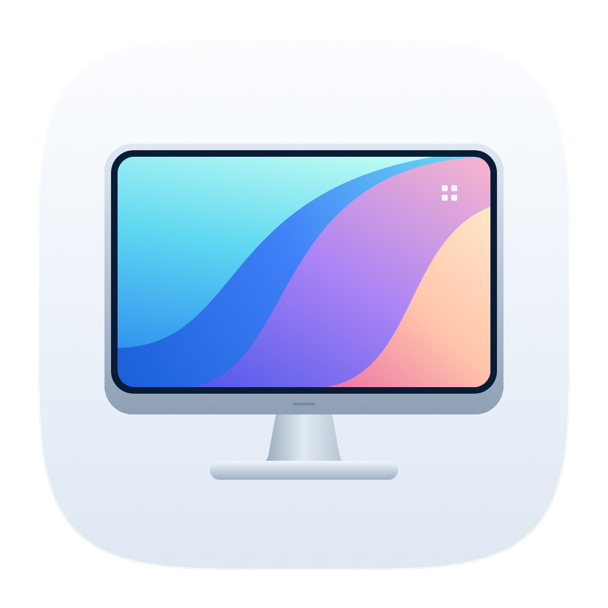
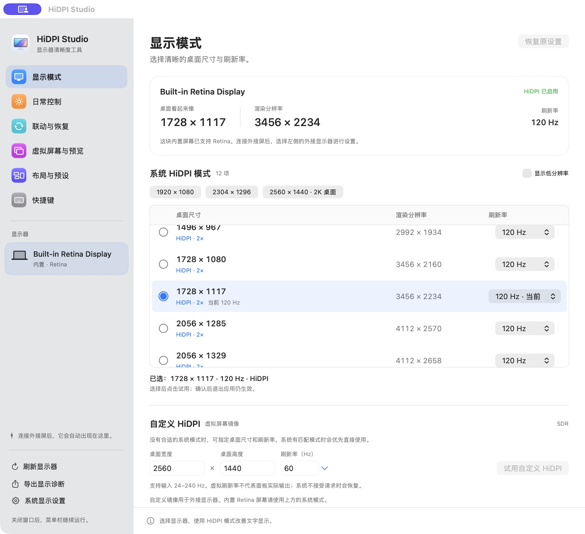
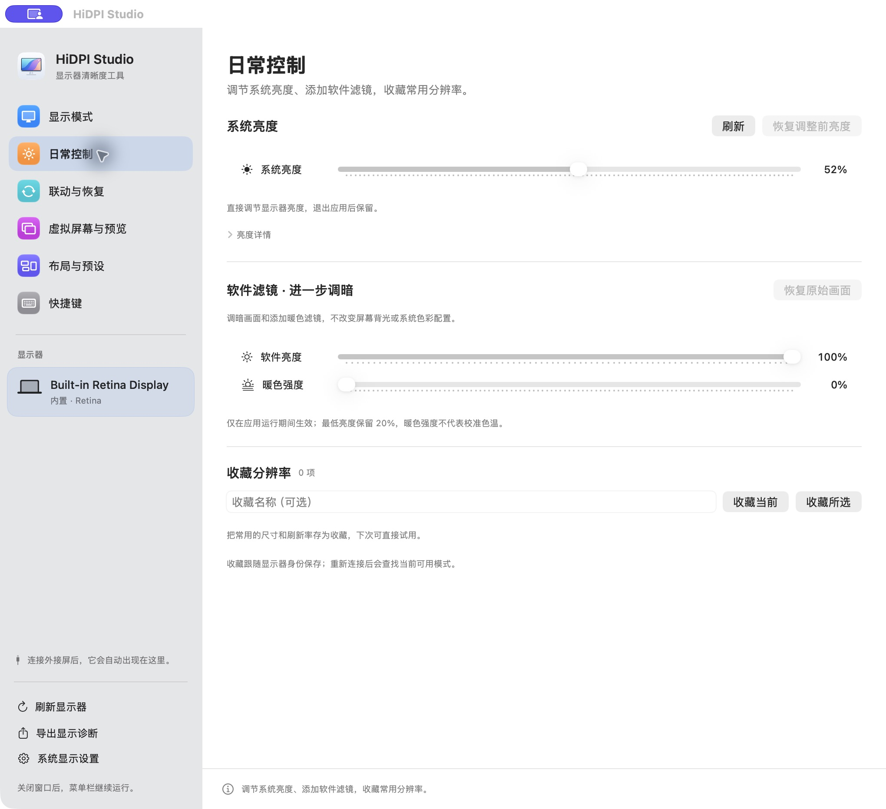

<p align="center">
  
</p>

<h1 align="center">HiDPI Studio</h1>

<p align="center">
  A native macOS display utility for sharper desktops, brightness control, and multi-display setups.
</p>

<p align="center">
  <a href="README.md">简体中文</a> · <strong>English</strong>
</p>

<p align="center">
  <a href="https://github.com/BrandonVee/HiDPIStudio/actions/workflows/build-release.yml"></a>
  <a href="https://github.com/BrandonVee/HiDPIStudio/releases"></a>
  <a href="#compatibility-and-permissions"></a>
  <a href="LICENSE"></a>
</p>

<p align="center">
  <a href="https://github.com/BrandonVee/HiDPIStudio/releases/download/v2.4.1/HiDPIStudio-v2.4.1-macOS-arm64.zip"><strong>Download for macOS</strong></a> ·
  <a href="#screenshots">Screenshots</a> ·
  <a href="CHANGELOG.md">Changelog</a> ·
  <a href="https://github.com/BrandonVee/HiDPIStudio/issues">Report an issue</a>
</p>

<p align="center">
  
</p>

<p align="center"><sub>Actual v2.4.0 interface · macOS 26.4 · built-in Retina display</sub></p>

## Getting started

1. Download [v2.4.1 for Apple Silicon](https://github.com/BrandonVee/HiDPIStudio/releases/download/v2.4.1/HiDPIStudio-v2.4.1-macOS-arm64.zip), or browse all [Releases](https://github.com/BrandonVee/HiDPIStudio/releases).
2. Unzip the download, move **HiDPI Studio.app** to **Applications**, and open it.
3. Select a display in the sidebar. When changing its resolution, try the mode and confirm within **15 seconds** to keep it.

> The app is **signed ad hoc**, and **not Developer ID signed or notarized by Apple**. If macOS blocks the first launch, follow the prompts in **System Settings → Privacy & Security** to allow the app to open.

You do not need to disable SIP or install display drivers. To verify your download, save the [SHA256 checksum file](https://github.com/BrandonVee/HiDPIStudio/releases/download/v2.4.1/HiDPIStudio-v2.4.1-SHA256SUMS.txt) alongside the ZIP and run:

```bash
shasum -a 256 --check HiDPIStudio-v2.4.1-SHA256SUMS.txt
```

## Features

| Feature | What it does |
| --- | --- |
| **HiDPI display modes** | Browse native modes grouped by desktop size and choose a refresh rate. Custom HiDPI supports 24–240 Hz: it prefers a matching native mode, otherwise mirrors a virtual Retina display. |
| **Menu bar control center** | A compact panel with wrapping display selection and no scrolling. Use a stepped resolution slider to preview sizes, release to try and confirm, and adjust brightness directly. Right-click keeps a native shortcut menu. |
| **System and DDC brightness** | Prefer the system brightness API, with DDC for supported external displays. Every write is checked by reading back the result. |
| **Separate software filters** | Dim the picture further or add warmth, with a 20% software-brightness floor. Filters do not change the panel's backlight. |
| **Virtual desktops and picture-in-picture** | Save up to eight virtual-display definitions and connect them on demand. Preview screens through ScreenCaptureKit at up to 1080p / 30 fps. |
| **Layouts, favorites, and presets** | Arrange displays, choose a main display, and save modes and layouts by display identity. Mode and layout changes include a confirmation trial. |
| **Brightness sync and automatic restore** | Follow built-in brightness using a separate ratio for each external screen, or restore a selected preset after wake or reconnection. Both are off by default. |
| **Keyboard controls** | Use custom shortcuts, or optionally route F1/F2 to a supported display under the pointer. Native brightness-key control is off by default. |

The interface uses native materials, continuous corners, and spring feedback, and respects Reduce Motion. The app contains no network requests, analytics, or license server.

## Screenshots

**Display modes:** the screenshot above shows desktop sizes, actual rendering resolutions, and refresh-rate selection for the connected display.

**Daily controls:** hardware brightness and software filters remain separate, with favorites for frequently used resolutions.

<p align="center">
  
</p>

These are real screenshots of v2.4.0 with a built-in Retina display connected. The app interface is currently in Simplified Chinese; the language links above switch the documentation. External-display capabilities depend on the hardware and connection.

## Everyday use

- **Quick adjustments:** left-click the menu bar icon to open the control center, or right-click for shortcuts. Closing the main window leaves the app running in the menu bar.
- **Save a setup:** create a preset under Layouts & Presets, then access it from the main window, menu bar, or a shortcut.
- **Enable automation:** select follower displays or a restore preset under Sync & Restore in the main window before enabling the corresponding feature. F1/F2 and global shortcuts are under Shortcuts.
- **Quit the app:** confirmed native display modes stay in effect. Virtual displays, mirroring, and software filters require the app to keep running.

## Compatibility and permissions

| Item | Current support |
| --- | --- |
| macOS | Deployment target: **macOS 13+**. Existing hardware checks used macOS 26.4 on an Apple M5 Pro. |
| Release binaries | **Apple Silicon / arm64**. No Intel installer is provided. |
| App language | Simplified Chinese. Documentation is available in Chinese and English. |
| Screen Recording | Requested only when you start a picture-in-picture preview. |
| Accessibility | Requested only when enabling native brightness-key control. Custom keyboard shortcuts do not need this permission. |

<details>
<summary><strong>Hardware support and implementation limits</strong></summary>

- DisplayServices, IOAVService, CGVirtualDisplay, and CGS extended modes include private system interfaces. Availability is checked at runtime; future macOS updates may affect them.
- DDC implements brightness `0x10` only, not a general VCP console. Intel DDC is not implemented. A dock, adapter, or monitor may not pass DDC commands through.
- The underlying synchronous IOAV calls have no interruptible hard deadline. A background queue and bounded retries are not a hard timeout.
- Hidden mode descriptors report integer Hz only. Applied modes are read back and restored on mismatch; arbitrary resolutions and refresh rates are not guaranteed to work.
- A virtual refresh rate does not guarantee the physical panel's output rate. Picture-in-picture captures no audio and does not forward mouse input.
- HDR/XDR brightness boosts, EDID overrides, forced RGB/YCbCr, physical-display soft disconnection, input/volume controls, and persistent layout locking are not implemented.

See the [validation record and remaining gaps](docs/VALIDATION.md) (Chinese).

</details>

## FAQ

**How do Retina and HiDPI relate?**

Retina is Apple's name for high pixel-density displays. HiDPI uses more pixels to draw the same-sized interface: for example, rendering a 2560 × 1440 desktop at 5120 × 2880 before outputting it to the display. Final sharpness still depends on the panel's physical resolution. Built-in Retina displays normally already use HiDPI.

**Why can't I change an external monitor's hardware brightness?**

The monitor and connection path must support DDC. Some docks and adapters do not forward control commands. The separate software filters can still dim the picture where supported, but do not change the backlight.

**Why is there a confirmation trial?**

A monitor may reject a mode or layout. The 15-second trial gives you time to keep or revert the change; an unconfirmed trial reverts automatically.

## Build from source

Install Apple Command Line Tools, including Swift and the macOS SDK. No third-party dependencies or full Xcode project are required.

```bash
git clone https://github.com/BrandonVee/HiDPIStudio.git
cd HiDPIStudio
./build.sh "$PWD/.build/HiDPI Studio.app"
open '.build/HiDPI Studio.app'
```

The script builds for the current Mac's architecture. Release packaging is validated for arm64 only. Recommended editor extensions are listed in [.vscode/extensions.json](.vscode/extensions.json); formatting is configured in [.swift-format](.swift-format) and [.clang-format](.clang-format).

### Checks and packaging

```bash
# Isolated preferences and mock I/O; no physical mode or brightness writes
'.build/HiDPI Studio.app/Contents/MacOS/HiDPIStudio' --test-ci

# Build, check, verify signatures, and generate ZIP + SHA256
./scripts/package.sh
```

Artifacts are written to `dist/`. `--test-virtual`, `--test-workspace`, and `--test-persistence` create temporary virtual displays. Checks that write physical brightness or modes also require an explicit choice and should not run as routine tests. See [validation details](docs/VALIDATION.md) (Chinese).

### CI/CD

- Push to `main`, open a PR against `main`, or run the workflow manually: build the ARM64 app, run isolated checks, and upload ZIP and SHA256 artifacts.
- Push a version tag: verify version consistency, then publish a stable release and mark it as Latest after successful checks.
- The maintainer's local publishing process backs up and verifies branches and tags on **GitLab before GitHub**.

See [Actions](https://github.com/BrandonVee/HiDPIStudio/actions) and the [release guide](docs/RELEASING.md) (Chinese).

<details>
<summary><strong>Source layout</strong></summary>

| Files | Responsibility |
| --- | --- |
| `DisplayCore.swift` / `HiddenDisplayModes.h/.m` | Native display modes, transactions, snapshots, and restoration. |
| `NativeBrightness.swift` / `DDCBrightness.swift` / `DDCTransport.h/.m` | System and DDC brightness. |
| `DailyControls.swift` | Software filters, favorites, and brightness UI. |
| `VirtualWorkspace.swift` / `ScreenPreview.swift` | Virtual desktops and picture-in-picture. |
| `LayoutProfiles.swift` / `AutoRestore.swift` | Layout presets and wake/reconnect restoration. |
| `BrightnessSync.swift` / `NativeBrightnessKeys.swift` | Brightness sync and native brightness keys. |
| `StudioView.swift` / `StatusPanel.swift` / `AppDelegate.swift` | Main window, menu bar control center, and lifecycle. |

</details>

## Contributing

Issue reports, documentation improvements, and pull requests are welcome. For compatibility reports, include your macOS and app versions, Mac chip, monitor model, connection path, reproduction steps, and expected behavior. You can export display diagnostics from the app; review the device information before sharing it.

- [Open an issue](https://github.com/BrandonVee/HiDPIStudio/issues/new) · [Existing issues](https://github.com/BrandonVee/HiDPIStudio/issues) · [Changelog](CHANGELOG.md)

## License and acknowledgments

Released under the [MIT license](LICENSE). HiDPI Studio is an independent implementation and is not affiliated with BetterDisplay.

System-interface and protocol references include [m1ddc](https://github.com/waydabber/m1ddc), [MonitorControl](https://github.com/MonitorControl/MonitorControl), [Crisp](https://github.com/didriksg/Crisp), and [Chromium's virtual-display tests](https://chromium.googlesource.com/chromium/src/+/HEAD/ui/display/mac/test/virtual_display_util_mac.mm). BetterDisplay's feature concepts are documented in its [official guide](https://betterdisplay.pro/guide/). No executables from these projects are bundled.
