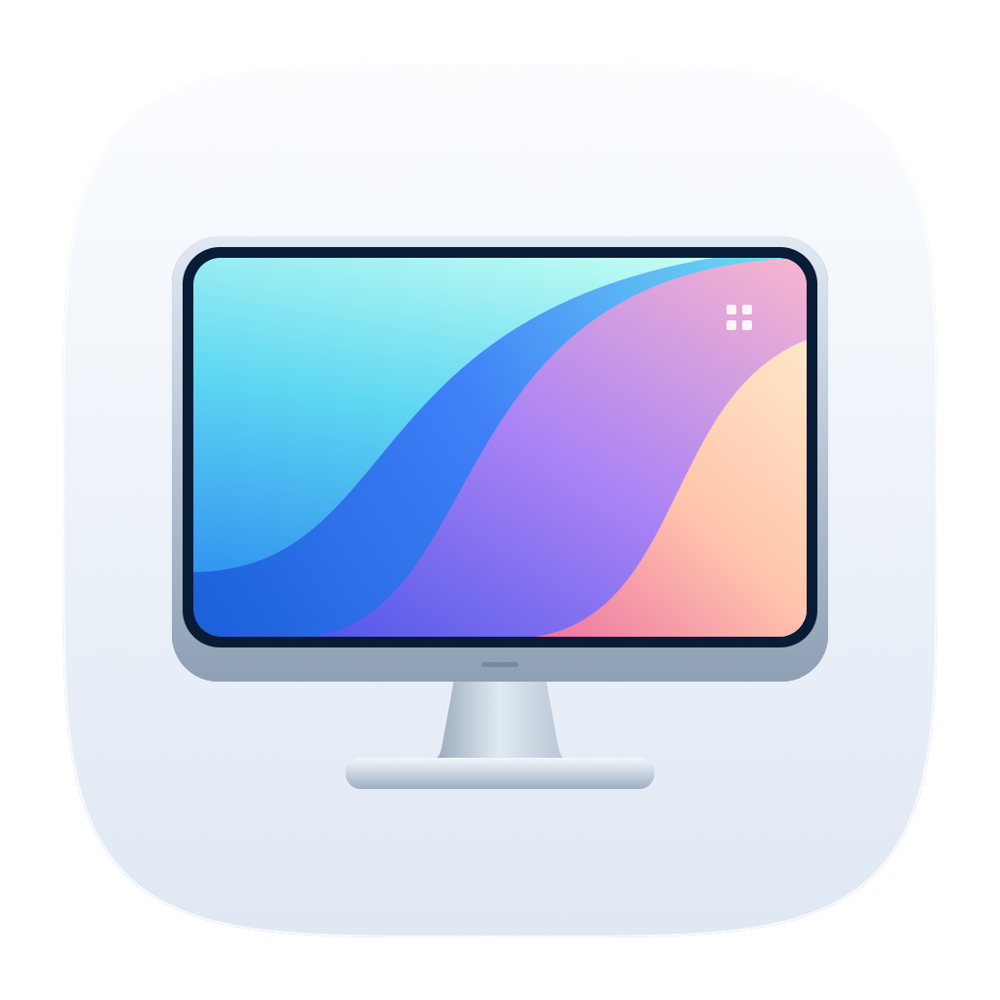
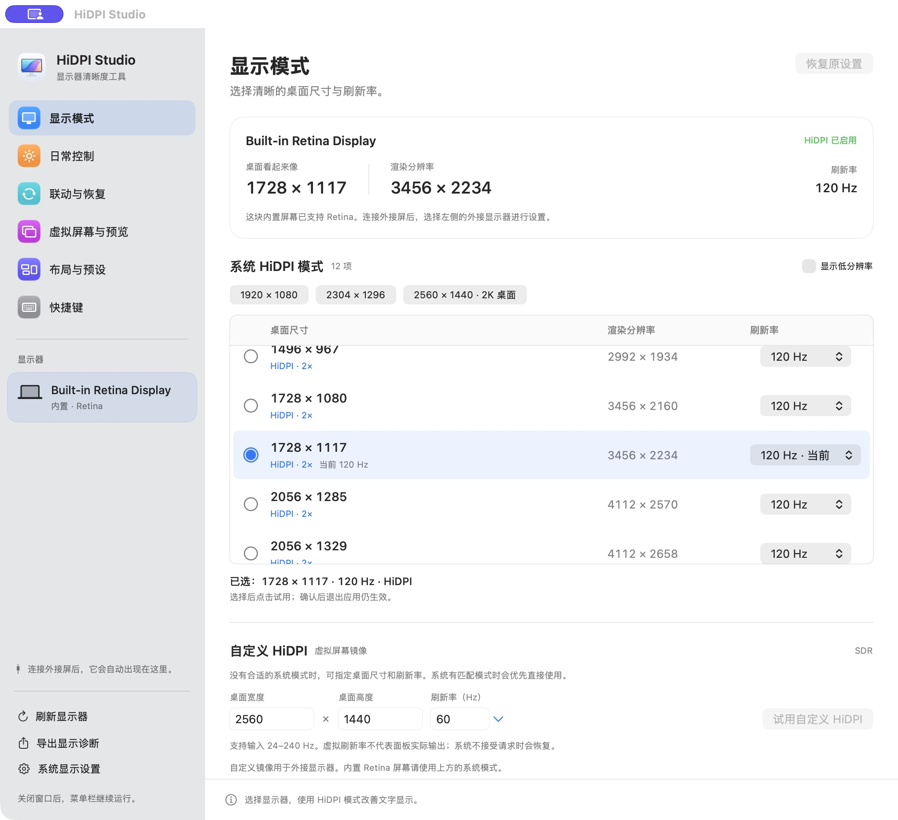
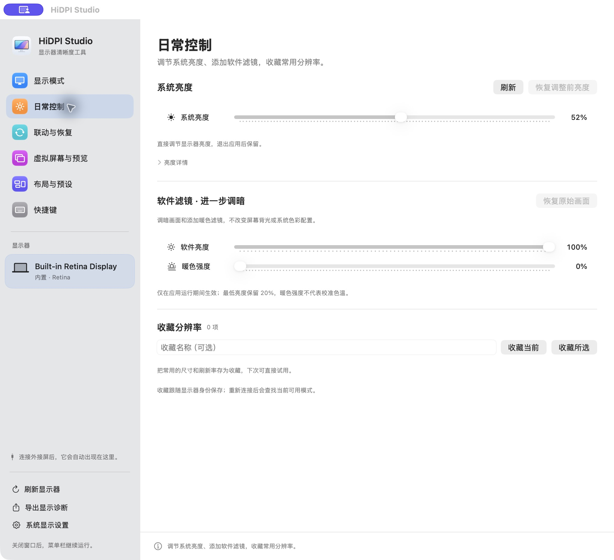

<p align="center">
  
</p>

<h1 align="center">HiDPI Studio</h1>

<p align="center">
  原生 macOS 显示管理工具，让清晰度、亮度和多屏配置触手可及。
</p>

<p align="center">
  <strong>简体中文</strong> · <a href="README.en.md">English</a>
</p>

<p align="center">
  <a href="https://github.com/BrandonVee/HiDPIStudio/actions/workflows/build-release.yml"></a>
  <a href="https://github.com/BrandonVee/HiDPIStudio/releases"></a>
  <a href="#兼容性与权限"></a>
  <a href="LICENSE"></a>
</p>

<p align="center">
  <a href="https://github.com/BrandonVee/HiDPIStudio/releases/download/v2.4.1/HiDPIStudio-v2.4.1-macOS-arm64.zip"><strong>下载 macOS 应用</strong></a> ·
  <a href="#界面预览">界面预览</a> ·
  <a href="CHANGELOG.md">更新记录</a> ·
  <a href="https://github.com/BrandonVee/HiDPIStudio/issues">问题反馈</a>
</p>

<p align="center">
  
</p>

<p align="center"><sub>v2.4.0 真实界面 · macOS 26.4 · 内置 Retina 屏幕</sub></p>

## 快速开始

1. 下载 [v2.4.1 · Apple Silicon](https://github.com/BrandonVee/HiDPIStudio/releases/download/v2.4.1/HiDPIStudio-v2.4.1-macOS-arm64.zip)，或在 [Releases](https://github.com/BrandonVee/HiDPIStudio/releases) 查看所有版本。
2. 解压，将 **HiDPI Studio.app** 移到“应用程序”文件夹后打开。
3. 在左侧选择显示器；调整分辨率后，先试用，再在 **15 秒内确认**保留。

> 当前安装包使用 **ad-hoc 签名**，尚未经 Developer ID 签名或 Apple 公证。首次打开如被 macOS 拦截，请按系统“隐私与安全性”中的提示允许打开。

应用不需要关闭 SIP 或安装显示器驱动。安装包附带 [SHA256 校验文件](https://github.com/BrandonVee/HiDPIStudio/releases/download/v2.4.1/HiDPIStudio-v2.4.1-SHA256SUMS.txt)，将它与 ZIP 放在同一目录后可运行：

```bash
shasum -a 256 --check HiDPIStudio-v2.4.1-SHA256SUMS.txt
```

## 功能亮点

| 功能 | 可以做什么 |
| --- | --- |
| **HiDPI 显示模式** | 按桌面尺寸分组浏览原生模式，选择刷新率；自定义 24–240 Hz HiDPI，优先匹配原生模式，否则使用虚拟 Retina 屏幕镜像。 |
| **菜单栏控制中心** | 紧凑快捷面板，显示器选择自动换行，无需滚动；用分档滑动条调整分辨率，松开后试用并确认，直接调节亮度；右键保留原生快捷菜单。 |
| **系统与 DDC 亮度** | 优先系统亮度接口，受支持的外接屏使用 DDC；写入后读回确认。 |
| **独立软件滤镜** | 进一步调暗画面或添加暖色，软件亮度保留最低 20%；不冒充硬件背光。 |
| **虚拟桌面与画中画** | 最多保存 8 个虚拟屏幕定义，按需连接；通过 ScreenCaptureKit 预览屏幕，最高 1080p / 30 fps。 |
| **布局、收藏与预设** | 调整相对位置和主屏，按显示器身份保存尺寸、刷新率与布局；模式和布局变更均有试用确认。 |
| **亮度联动与自动恢复** | 外接屏按各自比例跟随内置屏；唤醒或重连后恢复指定预设，两项功能均默认关闭。 |
| **键盘操作** | 自定义组合快捷键；可选用 F1/F2 控制鼠标所在的受支持屏幕，默认关闭。 |

界面使用原生材质、连续圆角与弹簧反馈，遵循系统“减少动态效果”设置。应用不包含联网请求、分析上报或许可证服务器。

## 界面预览

**显示模式**：上方截图展示桌面尺寸、实际渲染分辨率和刷新率选择。屏幕信息来自当前连接的设备。

**日常控制**：将硬件亮度与软件滤镜分开，收藏常用分辨率。

<p align="center">
  
</p>

截图取自真实 v2.4.0 应用，当前仅连接内置 Retina 屏幕；外接屏能力依硬件与连接方式而异。

## 使用方式

- **随手调整**：单击菜单栏图标打开控制中心，右键显示快捷菜单。关闭主窗口后仍在菜单栏运行。
- **保存桌面配置**：在“布局与预设”中保存，在主窗口、菜单栏或快捷键中调用。
- **开启自动化**：在主窗口的“联动与恢复”中选择跟随屏幕或恢复预设，再按需开启。F1/F2 和全局快捷键位于“软件设置”。
- **退出应用**：已确认的原生显示模式会保留；虚拟屏幕、镜像与软件滤镜需要应用持续运行。

## 兼容性与权限

| 项目 | 当前范围 |
| --- | --- |
| 系统 | 构建目标为 **macOS 13+**；已有硬件验证环境为 macOS 26.4 / Apple M5 Pro。 |
| 安装包 | **Apple Silicon / arm64**；未提供 Intel 安装包。 |
| 界面语言 | 简体中文；本文档提供中文、英文两个版本。 |
| 录屏权限 | 仅在主动启动画中画预览时请求。 |
| 辅助功能权限 | 仅在主动开启原生亮度键控制时请求；自定义组合快捷键不需要此权限。 |

<details>
<summary><strong>硬件能力与实现边界</strong></summary>

- DisplayServices、IOAVService、CGVirtualDisplay 和 CGS 扩展模式包含非公开系统接口，运行时检查兼容性；后续 macOS 更新可能影响可用性。
- DDC 仅实现亮度 `0x10`，不是通用 VCP 控制台。Intel DDC 尚未实现；扩展坞、转换器或显示器可能不传递 DDC。
- 底层 IOAV 同步调用没有可中断的硬截止时间；后台队列与有限重试不等于硬超时。
- 隐藏模式描述只报告整数 Hz，应用后会读回校验；不匹配时恢复，不能保证任意尺寸或刷新率均成功。
- 虚拟刷新率不代表面板实际输出。画中画不采集音频，也不转发鼠标。
- 未实现 HDR/XDR 超亮、EDID 覆写、强制 RGB/YCbCr、物理屏幕软断连、输入源/音量控制或持续布局锁定。

详见 [验证范围与未验证场景](docs/VALIDATION.md)。

</details>

## 常见问题

**Retina 与 HiDPI 是什么关系？**

Retina 是 Apple 对高像素密度显示屏的称呼。HiDPI 使用更多像素描绘同样大小的界面，例如按 5120 × 2880 渲染 2560 × 1440 的桌面，再输出到屏幕；最终清晰度仍受面板实际分辨率影响。内置 Retina 屏幕通常已经启用 HiDPI。

**外接屏无法调节硬件亮度怎么办？**

先确认显示器及连接路径支持 DDC。部分扩展坞或转换器不会转发控制命令；也可使用独立的软件滤镜进一步调暗画面。软件滤镜不改变显示器背光。

**为什么还保留试用确认？**

显示器可能无法接受某个模式或布局。15 秒试用给你确认或恢复的机会，超时会自动恢复。

## 从源码构建

需要 Apple Command Line Tools（Swift 与 macOS SDK），无需第三方依赖或完整 Xcode 工程。

```bash
git clone https://github.com/BrandonVee/HiDPIStudio.git
cd HiDPIStudio
./build.sh "$PWD/.build/HiDPI Studio.app"
open '.build/HiDPI Studio.app'
```

脚本按当前 Mac 架构构建，发布安装包仅验证 arm64。推荐的编辑器扩展见 [.vscode/extensions.json](.vscode/extensions.json)，格式规范保存在 [.swift-format](.swift-format) 和 [.clang-format](.clang-format)。

### 检查与打包

```bash
# 隔离偏好与模拟 I/O 检查，不写入实体显示模式或硬件亮度
'.build/HiDPI Studio.app/Contents/MacOS/HiDPIStudio' --test-ci

# 构建、检查、验证签名、生成 ZIP 与 SHA256
./scripts/package.sh
```

产物位于 `dist/`。`--test-virtual`、`--test-workspace` 和 `--test-persistence` 会创建临时虚拟屏幕；实体亮度/模式写入测试也需要明确选择，不应作为日常检查自动运行。详见 [验证说明](docs/VALIDATION.md)。

### CI/CD

- 推送 `main`、向 `main` 提交 PR 或从分支手动运行：构建 ARM64 应用、运行隔离检查、上传 ZIP 与 SHA256 构建产物；从版本标签手动运行会继续执行正式 Release 发布。
- 推送版本标签：检查版本一致性，通过后自动发布正式 Release 并标记为 Latest。
- 本机发布按 **GitLab → GitHub** 的顺序备份并校验分支和标签。

查看 [Actions](https://github.com/BrandonVee/HiDPIStudio/actions) 或 [完整发布流程](docs/RELEASING.md)。

<details>
<summary><strong>代码结构</strong></summary>

| 文件 | 职责 |
| --- | --- |
| `DisplayCore.swift` / `HiddenDisplayModes.h/.m` | 原生显示模式、事务、快照与恢复。 |
| `NativeBrightness.swift` / `DDCBrightness.swift` / `DDCTransport.h/.m` | 系统与 DDC 亮度控制。 |
| `DailyControls.swift` | 软件滤镜、收藏与亮度界面。 |
| `VirtualWorkspace.swift` / `ScreenPreview.swift` | 虚拟桌面及画中画。 |
| `LayoutProfiles.swift` / `AutoRestore.swift` | 布局预设与唤醒/重连恢复。 |
| `BrightnessSync.swift` / `NativeBrightnessKeys.swift` | 亮度联动与原生亮度键。 |
| `StudioView.swift` / `StatusPanel.swift` / `AppDelegate.swift` | 主窗口、菜单栏控制中心与生命周期。 |

</details>

## 参与项目

欢迎问题反馈、文档改进和 Pull Request。报告兼容性问题时，请附上 macOS 与应用版本、Mac 芯片、显示器型号、连接方式、复现步骤和预期行为；必要时可通过应用导出显示诊断，并在分享前检查其中的设备信息。

- [提交问题](https://github.com/BrandonVee/HiDPIStudio/issues/new) · [查看已有问题](https://github.com/BrandonVee/HiDPIStudio/issues) · [更新记录](CHANGELOG.md)

## 许可与致谢

使用 [MIT 许可证](LICENSE)。HiDPI Studio 为独立实现，与 BetterDisplay 无关联。

系统接口与协议语义参考 [m1ddc](https://github.com/waydabber/m1ddc)、[MonitorControl](https://github.com/MonitorControl/MonitorControl)、[Crisp](https://github.com/didriksg/Crisp) 和 [Chromium 的虚拟显示测试](https://chromium.googlesource.com/chromium/src/+/HEAD/ui/display/mac/test/virtual_display_util_mac.mm)。BetterDisplay 的功能概念说明见其[官方文档](https://betterdisplay.pro/guide/)。项目未捆绑这些项目的可执行程序。
